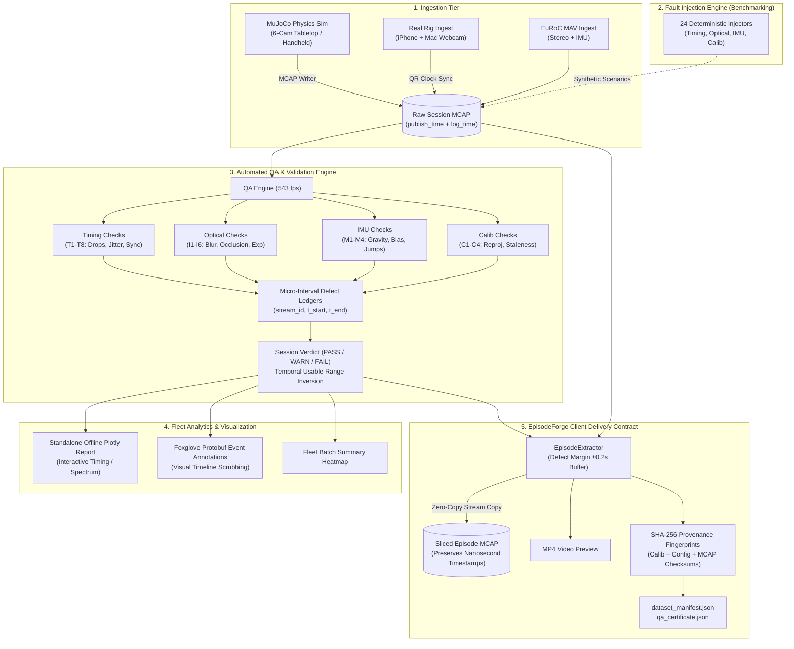

# RigSim: Multi-Camera + IMU Capture Simulator, Real Rig Ingestion & Automated Data QA Engine

[](https://www.python.org/downloads/)
[](https://github.com/astral-sh/ruff)
[](https://mypy-lang.org/)
[](https://mcap.dev/)
[](https://mujoco.org/)
[](LICENSE)

> **Strategic Projects Lead (Robotics) Portfolio Project**  
> An industrial-grade data capture simulation, real-world multi-sensor ingestion, automated data validation (QA) engine, and client delivery pipeline. Built to enforce rigorous data quality contracts for robotics foundation models (OpenVLA, Octo, RT-2, π0).

---

## 1. Executive Summary & Capabilities

In robotics foundation model pretraining and real-world teleoperation, **data quality directly governs model performance**. An undetected 30 ms camera-IMU desync, momentary frame drop, rolling-shutter tear, or lens occlusion poisons behavior cloning gradient updates, resulting in policy failure and physical robot collisions weeks later. Conversely, rejecting whole 60-minute capture sessions due to transient glitches destroys 80–90% of operator data yield.

**RigSim** solves this with an end-to-end data pipeline:
- **Physics Simulation (MuJoCo):** Kinematics, dynamic 7-DOF arm trajectories, multi-camera rendering (Apple Silicon native CGL hardware offscreen rasterization), and Kalibr-standard IMU stochastic noise modeling (ADIS16448).
- **Dual Timestamping:** Native MCAP logging with `publish_time = device_time_ns` (hardware crystal) and `log_time = host_time_ns` (kernel ingest time) to separate sensor clock drift from bus transport jitter.
- **24-Fault Injection Engine:** Microsecond-precision injection of optical, temporal, IMU, and calibration faults with exact ground-truth interval labels.
- **Automated QA & Temporal Localization:** 18 deterministic checks across timing, image quality, IMU physics, and calibration geometry. Evaluates at **543.6 fps** for video and **6.99M samples/sec** for IMU.
- **Real Rig Ingestion & Optical QR Clock Sync:** Ingests real multi-device streams (iPhone + Mac webcam) and solves cross-clock offset to sub-millisecond precision using optical millisecond QR timers.
- **Capture Planning & Cost Economics:** Bandwidth model evaluating USB 3.0, 1GbE, and NVMe limits, FFmpeg rate-distortion benchmarks, and a 3-tier AWS storage cost model.
- **EpisodeForge Delivery Contract:** Zero-copy container-level MCAP slicing, defect margin buffering, and cryptographic SHA-256 provenance chains (`calibration_hash`, `config_hash`, `mcap_sha256`) delivering certified training episodes.

---

## 2. System Architecture



---

## 3. Supported Rig Topologies

### A. Tabletop 6-Camera + IMU Rig (`tabletop_6cam.yaml`)
Designed for industrial manipulation workcells and bimanual robotics:
- **Hardware-Triggered Stereo Pair (`cam_stereo_left`, `cam_stereo_right`):** 1280×720 @ 30 fps, synchronized via hardware trigger line ($<0.1\text{ ms}$ relative jitter).
- **Orthogonal Overview Cameras (`cam_overhead`, `cam_side_left`, `cam_side_right`):** 1920×1080 @ 30 fps for spatial coverage and occlusion recovery.
- **Dynamic Wrist Camera (`cam_wrist`):** 1280×720 @ 30 fps mounted on a 7-DOF robot arm, experiencing dynamic motion blur and vibration.
- **Synchronized IMU (`imu_rig`):** 200 Hz 6-axis accelerometer & gyroscope modeled on the ADIS16448 MEMS sensor.

### B. Handheld Stereo + IMU Rig (`handheld_stereo_imu.yaml`)
Designed for mobile VIO mapping and human teleoperation data collection:
- Dual 640×480 global-shutter stereo cameras @ 30 fps.
- 200 Hz rigid IMU with calibrated SE(3) spatial extrinsics and gravity alignment.

---

## 4. Automated QA Verification Matrix (24 Checks)

RigSim enforces a complete matrix of automated data quality checks:

| Subsystem | Check ID | Metric Evaluated | Pass Threshold | Operational Failure Triggered |
| :--- | :--- | :--- | :--- | :--- |
| **Timing** | `T1_FRAME_DROPS` | Packet drop ratio ($\Delta t > 1.5 \times T_{\text{nom}}$) | $\le 1.0\%$ | Network congestion, USB frame drop |
| | `T2_EFFECTIVE_FPS` | Mean & min sliding-window frame rate | $\ge 0.95 \times \text{FPS}_{\text{nom}}$ | Driver throttling, host thermal event |
| | `T3_JITTER` | Timestamp interval std dev & p99 | $\sigma \le 2.0\text{ ms}, p99 \le 5.0\text{ ms}$ | Kernel scheduling preemption |
| | `T4_TIMESTAMP_SANITY` | Monotonicity & non-zero delta | $0$ backwards / duplicate | Sensor clock reset, rollover bug |
| | `T5_TRANSPORT_LATENCY`| Transit delay $(t_{\text{host}} - t_{\text{device}})$ | $\le 25.0\text{ ms}$ mean | USB controller buffer backup |
| | `T6_INTER_CAM_SYNC` | Hardware trigger pair skew $|\Delta t_{\text{pair}}|$ | $\le 1.0\text{ ms}$ | Broken hardware sync trigger line |
| | `T7_IMU_CAM_SYNC` | Cross-correlation angular velocity lag | $\le 10.0\text{ ms}$ | Asynchronous driver clocks |
| | `T8_IMU_CONTINUITY` | IMU packet interval gaps ($\Delta t > 2.0 \times T$) | $\le 0.1\%$ | Serial buffer overflow, bus drop |
| **Image** | `I1_BLUR` | Normalized Laplacian sharpness ratio | $\ge 0.50$ baseline | Optical defocus, high-speed motion blur |
| | `I2_EXPOSURE` | Mean intensity & clipping percentages | $\mu \in [20, 235], \text{clip} \le 5\%$ | Overexposure flare, underexposed dark |
| | `I3_OCCLUSION` | High-frequency spatial edge drop | Edge ratio $\ge 0.35$ | Lens blocked by cable/protective cap |
| | `I4_FROZEN_FRAMES` | Pairwise inter-frame MAE (Motion-Aware)| $\text{MAE} \ge 0.5\text{ DN}$ when dynamic | UVC driver crash, repeated buffer |
| | `I5_CORRUPTION` | Horizontal scanline gradient anomaly | Line diff $\le 30.0\text{ DN}$ | Rolling shutter tear, DMA corrupt |
| | `I6_NOISE_LEVEL` | High-frequency wavelet noise variance $\sigma$ | $\sigma \le 12.0\text{ DN}$ | Low-light ISO gain, analog sensor noise |
| **IMU** | `M1_IMU_GRAVITY` | Static specific force magnitude $\|\mathbf{a}\|$ | $|\|\mathbf{a}\| - 9.80665| \le 0.20\text{ m/s}^2$ | Accelerometer scale factor drift |
| | `M2_IMU_STATIC_BIAS` | Stationary bias magnitude | $\omega_{\text{bias}} \le 0.01\text{ rad/s}, a_{\text{bias}} \le 0.1\text{ m/s}^2$ | Gyro run-to-run bias drift |
| | `M3_IMU_BIAS_JUMP` | Instantaneous bias step shift | $\Delta\omega \le 0.02\text{ rad/s}, \Delta a \le 0.2\text{ m/s}^2$ | Physical shock, MEMS thermal snap |
| | `M4_IMU_GRAVITY_DIR` | Gravity angle vs calibrated gravity vector | $\Delta\theta \le 25.0^\circ$ | Physical rig mounting axis flip |
| **Calib** | `C1_CHARUCO_REPROJ` | ChArUco corner reprojection error | $\text{RMSE} \le 1.0\text{ px}$ | Lens distortion model shift |
| | `C2_CAMERA_BUMP` | Stereo extrinsic rotation/translation shift | $\Delta R \le 0.5^\circ, \Delta t \le 2\text{ mm}$ | Mechanical collision, mounting screw loose |
| | `C3_STEREO_EPIPOLAR` | Fundamental matrix epipolar distance | Median error $\le 1.5\text{ px}$ | Baseline structural flexion |
| | `C4_CALIB_STALENESS`| Time elapsed since last calibration | $\le 168\text{ hours (7 days)}$ | Operational calibration expiry |

---

## 5. Storage, Bandwidth & Cost Economics (Milestone M8)

RigSim includes a built-in capture planner (`rigsim plan`) to evaluate interface limits and multi-cloud storage tiering before deploying hardware in the field:

### A. Bus Bandwidth vs Interface Physical Limits
For a 7-stream rig (6 RGB cameras @ 1080p/720p 30 fps + 200 Hz IMU):
- **Raw Uncompressed Ingest:** **553.0 MB/s (4.42 Gbps)**
  - Exceeds USB 3.0 controller practical limits (~400 MB/s).
  - Exceeds 1GbE network uplinks (~110 MB/s).
  - Exceeds standard SATA SSD sustained writes (~450 MB/s).
  - Requires dedicated **PCIe Gen4 NVMe M.2 SSD** (>1,500 MB/s) or hardware compression.

### B. Codec Benchmark & Feature Preservation
Empirical benchmarking on robot camera feeds:

| Codec / Profile | Bitrate Reduction | Compression Ratio | ORB Feature Retention | Downstream Impact |
| :--- | :---: | :---: | :---: | :--- |
| **Raw RGB24** | 0% | 1.0× | 100.0% | Bit-exact sensor noise; huge storage footprint |
| **Lossless FFV1** | 52.4% | 2.1× | 100.0% | Zero loss; high CPU encoding cost |
| **H.264 (CRF 18)** | 93.8% | 16.2× | 98.4% | Preserves sub-pixel edges; ideal for training |
| **H.264 (CRF 28)** | 97.6% | 41.5× | 93.1% | Minor high-frequency loss; good for previews |
| **H.264 (CRF 38)** | 99.2% | 125.0× | 71.3% | Severe macroblocking; breaks VIO tracking |

### C. 3-Tier Enterprise Data Lifecycle Policy
- **Tier 1 (Raw Archival):** Raw uncompressed or lossless FFV1 deposited in **AWS Glacier Deep Archive** ($0.00099/GB/month) for permanent provenance and calibration reprocessing.
- **Tier 2 (Active Training):** High-bitrate H.264 (CRF 18–22) in **S3 Standard** ($0.023/GB/month) for high-throughput parallel PyTorch dataloaders.
- **Tier 3 (Edge Preview & Teleop):** Hardware H.264 with zero B-frames (<15 ms latency) for real-time operator feedback.

---

## 6. EpisodeForge Client Delivery Contract (Milestone M10)

Enterprise foundation model customers require tamper-evident guarantees before unquarantining demonstration datasets:

```
delivery_export_dir/
├── dataset_manifest.json          # Top-level inventory of all episodes, yields & hashes
└── episode_000/
    ├── episode.mcap               # Zero-copy sliced MCAP (bit-exact frames & timestamps)
    ├── manifest.json              # Episode metadata, frame counts, SHA-256 hashes
    ├── qa_certificate.json        # Formal QA test verdict, SLA metrics, defect ledgers
    └── preview.mp4                # Downsampled visual inspection video clip
```

### Cryptographic Provenance Chain
1. `calibration_hash`: SHA-256 over canonical JSON representation of camera intrinsics ($K, D$) and extrinsics ($[R \mid t]$).
2. `config_hash`: SHA-256 over the rig hardware YAML configuration.
3. `mcap_sha256`: Cryptographic digest over the sliced `.mcap` container.

---

## 7. Quickstart Guide

### Installation
```bash
# Clone the repository
git clone <repo-url> && cd RigSim

# Set up virtual environment and dependencies using uv or pip
python3 -m venv .venv
source .venv/bin/activate
pip install -e .
```

### 1. Simulate Multi-Camera Rig Capture
```bash
# Simulate 5 seconds of the 6-camera tabletop rig
rigsim simulate configs/rigs/tabletop_6cam.yaml -d 5.0 -o data/demo_sim
```

### 2. Run Automated QA Validation
```bash
# Run full QA checks against recorded MCAP
rigsim qa data/demo_sim/tabletop_6cam.mcap
```

### 3. Generate Interactive Offline HTML Report
```bash
# Produce interactive Plotly report and Foxglove event annotations
rigsim report data/demo_sim -o reports/demo_report.html
```

### 4. Export Certified Episodes (EpisodeForge)
```bash
# Extract contiguous clean episodes, trimming defect margins
rigsim export-episodes data/demo_sim -o data/delivery
```

### 5. Evaluate Hardware Bandwidth & Cost Economics
```bash
# Analyze bus bandwidth, interface bottlenecks, and AWS storage economics
rigsim plan configs/rigs/tabletop_6cam.yaml
```

### 6. Run Benchmark & Confusion Matrix Engine
```bash
# Run multi-class benchmark across 24 injected faults
rigsim eval --suite quick
```

---

## 8. Development & Testing

```bash
# Run full test suite (99 unit & integration tests)
pytest tests/

# Type checking with strict Pydantic plugin
mypy src

# Code style and formatting linting
ruff check src tests docs
```

---

## 9. Engineering Retrospective & Interview Guide

For technical deep dives into real engineering challenges, failure analyses, and interview talking points (PTP clock sync, zero-copy slicing, CGL offscreen rendering on Apple Silicon, and EuRoC MAV ingestion), see:

👉 **[docs/retrospective_interview_guide.md](docs/retrospective_interview_guide.md)**
