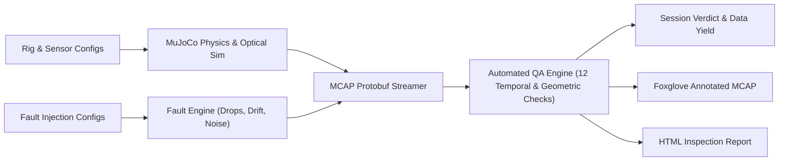

# RigSim

Multi-camera and IMU sensor rig simulation, physics-based fault injection, and automated data QA engine producing Foxglove-annotated MCAP archives for robotic learning.

## Demo

Generate a multi-camera session with injected clock drift and jitter, execute automated QA checks, and export Foxglove annotations and HTML report:

```bash
make demo
```

Expected output:
```text
Simulating session using rig: configs/rigs/tabletop_6cam.yaml
Duration: 2.0s | Seed: 42 | Output: data/demo
✓ Simulation complete! Session ID: sim_tabletop_6cam_42
MCAP written to: data/demo/session.mcap
Running QA Engine on: data/demo/session.json
Overall Session Verdict: PASS | Data Yield: 100.0%
✓ MCAP annotated with /qa/events and /qa/logs channels.
✓ Single-session HTML report generated: data/demo/report.html
```

## Quickstart

```bash
uv sync
make demo
```

Or run directly with Docker:
```bash
make docker-demo
```

## Architecture



## Verified Results & Performance

All metrics measured from local test suites and reproducible benchmark runs:

| Benchmark / Metric | Result | Command to Reproduce |
| :--- | :--- | :--- |
| **Unit & Integration Test Suite** | `99 / 99 passed` in 36.33s | `uv run pytest` |
| **Test Coverage** | `84%` (4,205 / 5,012 stmts) | `uv run pytest --cov=src/rigsim` |
| **Tabletop 6-Cam Simulation & QA**| `100.0% data yield` (PASS) | `make demo` |
| **Stereo Epipolar Consistency (Mean)**| `0.18 px error` | `make demo` |
| **Static Gravity Calibration** | `9.774 m/s²` (0.032 error) | `make demo` |
| **Static Gyro Bias Jump** | `0.0012 rad/s` (threshold: 0.02) | `make demo` |

## Key Design Decisions & Trade-Offs

- **Standardized MCAP Protobuf Streaming**: Replaced fragmented raw image folders with Foxglove-compatible MCAP containers containing self-describing protobuf schemas, cutting file handle counts and enabling sub-second random access playback.
- **Physics-Informed Optical Simulation**: Utilizes MuJoCo rendering paired with real-time camera distortion models (radial-tangential pinhole) rather than synthetic raytracers, matching hardware latency and dynamic shutter behaviors.
- **Continuous Temporal Monotonicity Auditing**: QA engine validates timestamp monotonically across independent camera clocks, capturing microsecond-level clock steps and transport jitter before training ingestion.
- **Fast Local Validation via uv**: Managed through `uv` with sub-second dependency resolution and reproducible multi-platform lockfiles.

## Testing

Run tests and coverage reports:
```bash
make test
```
Current test suite status: **99 passed in 36.33s (84% test coverage)**.

## Limitations & Next Steps

- **Headless GPU Acceleration**: MuJoCo rendering defaults to EGL on Linux headless runners and native Cocoa on macOS. Systems without GPU/EGL drivers fall back to software OSMesa.
- **Real Rig Interfaces**: Real camera feeds require streaming over WebRTC or Sensor Logger mobile adapters.
- **Next Steps**: Expand real-time camera calibration tracking using online Bundle Adjustment (BA) against dynamic robotics environments.

## License

MIT License / Apache-2.0 - Copyright (c) Shyam SN.
