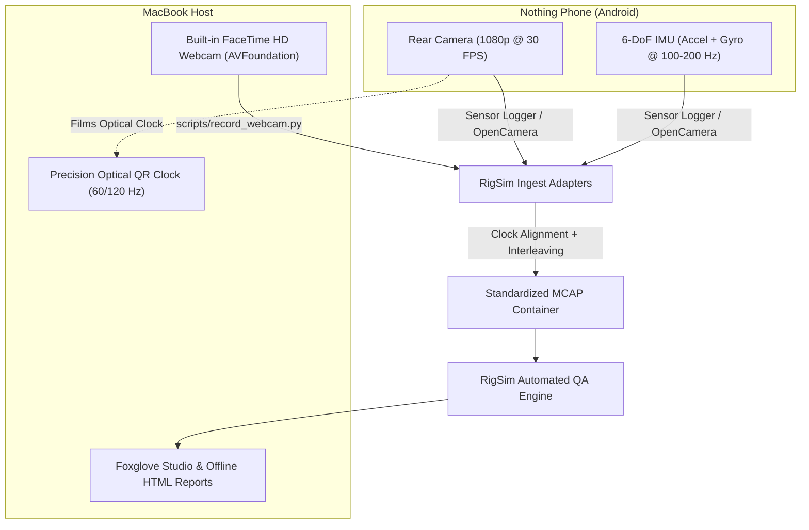
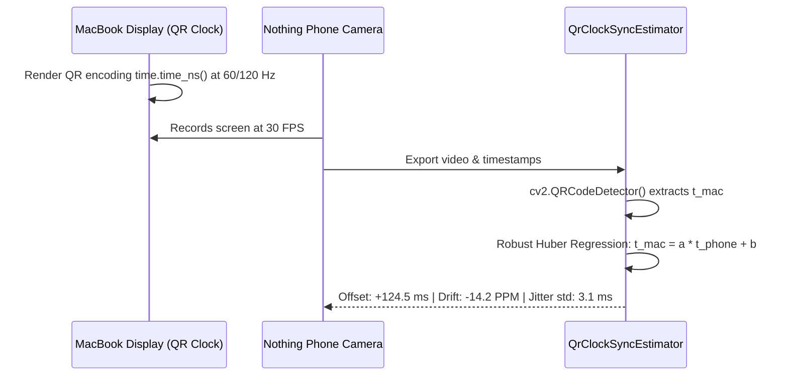

# Real Rig Capture & Operational Protocol Guide: Nothing Phone + MacBook

This guide provides an end-to-end operational protocol for capturing multi-modal robotics data using a **Nothing Phone (Android)** and a **MacBook**, achieving cross-device optical clock synchronization, intrinsic/stereo calibration, and automated QA validation.

---

## 1. Hardware & System Architecture



### Sensor Specifications
| Device | Sensor | Stream ID | Nominal Rate | Format / Precision |
| :--- | :--- | :--- | :--- | :--- |
| **Nothing Phone** | Main RGB Camera | `phone_cam` | 30.0 FPS | 1080p (1920×1080) Global/Rolling Shutter |
| **Nothing Phone** | Invensense/Bosch IMU | `phone_imu` | 100–200 Hz | 3-axis Accelerometer + 3-axis Gyroscope |
| **MacBook** | FaceTime HD Webcam | `webcam` | 30.0 FPS | 720p / 1080p AVFoundation |
| **MacBook** | System Display | `mac_clock` | 60 / 120 Hz | Apple ProMotion Retina (~254 PPI) |

---

## 2. Phone Application Setup

### Option A: Sensor Logger (Recommended)
1. Install **Sensor Logger** from Google Play Store (by Sorenson).
2. Open Settings:
   - **Sampling Rate:** Select `Fastest` or `100 Hz`.
   - **Sensors:** Enable `Total Accelerometer` and `Gyroscope`.
   - **Camera:** Enable `Video Recording` (1080p, 30 FPS).
3. To Record:
   - Tap the red record button. Perform capture.
   - Tap Stop. Go to Recordings → Export as `.zip`.
   - Transfer the ZIP file to your Mac via AirDrop, Google Drive, or USB (`adb pull`).
4. Ingest into RigSim:
   ```bash
   rigsim ingest sensorlogger path/to/recording.zip -o data/phone_sessions/session_01 --qa
   ```

### Option B: OpenCamera Sensors
1. Install **OpenCamera Sensors** (open-source Android app).
2. Video Settings: Set to 1080p 30 FPS, hardware video stabilization `OFF`.
3. Sensor Settings: Enable `Log Accelerometer + Gyroscope to CSV`.
4. Ingest into RigSim:
   ```bash
   rigsim ingest opencamera path/to/folder -o data/phone_sessions/session_01 --qa
   ```

---

## 3. Mac Webcam Recording

To record from your MacBook's webcam with dual nanosecond timestamps:

> [!NOTE]
> **macOS Camera Permission:**
> Ensure your Terminal or IDE has Camera permission enabled in:
> `System Settings → Privacy & Security → Camera`.

Run the AVFoundation recorder:
```bash
python scripts/record_webcam.py -o data/webcam_session -w 1280 -h 720 -f 30 -t 30
```
This writes:
- `recording.mcap`: High-throughput MCAP containing `/webcam/image_compressed`, calibration, and TF.
- `session.json`: Pydantic Session manifest.
- `timestamps.csv`: Nanosecond hardware and host timestamps for every grab.

---

## 4. Cross-Device Clock Synchronization (The QR Clock)

Android smartphones and MacBooks operate on completely separate quartz crystals that drift by **10 to 80 PPM** (0.6 to 4.8 ms per minute). To synchronize them to sub-millisecond precision without hardware trigger lines, we use an **Optical QR Clock**.



### Step 1: Start QR Clock on Mac
```bash
python scripts/qr_clock.py --duration 120 --size 650
```
This displays a full-screen, high-contrast QR code updating at display refresh rate (60 Hz or 120 Hz ProMotion) and logs display timestamps to `data/qr_clock_log.csv`.

### Step 2: Record with Phone
1. Hold the phone steady, framing the QR code in the center 60% of the viewfinder.
2. Record for 1 to 2 minutes. Avoid extreme rapid panning to prevent motion-blurring the QR code.

### Step 3: Run Synchronization Fit
```bash
rigsim sync qr data/phone_sessions/session_01
```
Or directly on a video file:
```bash
rigsim sync qr path/to/phone_video.mp4
```

### Fitted Clock Model & Error Budget
The estimator fits:
$$t_{\text{mac}} = a \cdot t_{\text{phone}} + b$$
- **Relative Drift (PPM):** $(a - 1.0) \times 10^6$
- **Initial Offset ($b$):** Difference at recording start (in ms)
- **Error Budget Breakdown:**
  - Display refresh quantization: $\frac{1000}{2 \times f_{\text{display}}} \approx 8.3\text{ ms}$ (at 60 Hz) or $4.1\text{ ms}$ (at 120 Hz).
  - Rolling shutter line skew: $\approx 6.0\text{ ms}$ across frame center.
  - Camera exposure centroid: $\approx 8.3\text{ ms}$ at 30 FPS.

---

## 5. Handheld IMU–Camera Temporal Calibration (T7 Excitation)

To verify the internal hardware synchronization between the phone's camera sensor and its internal IMU:

### Excitation Routine Protocol
1. Hold the phone firmly with both hands in portrait or landscape.
2. Ensure the room has textured visual features (shelves, books, posters, corners).
3. Perform the following sequence over a 30-second recording:
   - **0s–5s (Static Baseline):** Rest the phone motionless on a flat table (records static gravity and gyro bias).
   - **5s–12s (Yaw):** Smooth rotations left-to-right ($\pm 45^\circ$) around the vertical axis.
   - **12s–19s (Pitch):** Smooth rotations up-and-down ($\pm 35^\circ$) around the lateral axis.
   - **19s–26s (Roll):** Gentle wrist rotations tilting the screen left and right.
   - **26s–30s (Rapid Shake):** Short, crisp multi-axis oscillations.

### Run Temporal Offset Estimator
```bash
rigsim sync imu-cam data/phone_sessions/session_01 --camera phone_cam
```
The estimator tracks Shi-Tomasi corners using Lucas-Kanade optical flow, solves for rotational velocity using Polar SVD homography decomposition, and cross-correlates against $\|\boldsymbol{\omega}\|_{\text{gyro}}$.
- **Acceptance SLA:** Hardware offset $|\tau| < 5.0\text{ ms}$ with peak correlation $r > 0.70$.

---

## 6. Geometric Calibration (ChArUco Board)

### Step 1: Display Target on Mac
```bash
python scripts/show_charuco.py --squares-x 7 --squares-y 5 --square-mm 40.0 --dpi 254
```
> [!IMPORTANT]
> **Ruler Verification:** Hold a physical ruler up to your laptop screen and confirm that one chessboard square measures exactly **40.0 mm** wide. If your screen scaling differs, adjust `--dpi`.

### Step 2: Capture Calibration Views
1. Film the screen from 0.4 m to 1.0 m away with the phone or webcam.
2. Slowly tilt the camera at varied angles: front-facing, tilted $20^\circ$ left, right, top, bottom, and across all 4 screen corners to ensure complete lens coverage.

### Step 3: Run Calibration
```bash
rigsim calibrate data/phone_sessions/calib_session
```
Outputs intrinsic focal lengths $(f_x, f_y)$, principal point $(c_x, c_y)$, radial distortion coefficients, and reprojection RMS (target $< 0.50\text{ px}$).

---

## 7. Real Fault Capture Checklist & Ground-Truth Labelling

For empirical QA engine benchmarking, record real intentional defect sessions using the following checklist:

| Defect Type | Capture Procedure | Target QA Check |
| :--- | :--- | :--- |
| **Motion Blur** | Shake the phone rapidly back and forth in front of textured objects for 5 seconds. | `I1_BLUR` |
| **Under / Over Exposure** | Film in a dark room, then abruptly point directly into a bright flashlight or desk lamp. | `I2_EXPOSURE` |
| **Lens Occlusion** | Cover 80% of the camera lens with your index finger for 4 seconds, then remove it. | `I3_OCCLUSION` |
| **FPS Drop / Stutter** | Run heavy 3D benchmark app or battery saver mode in the background while recording. | `T1_FRAME_DROPS`, `T2_EFFECTIVE_FPS` |
| **Camera Mount Bump** | Firmly tap or jostle the phone mount during a ChArUco / fiducial tracking session. | `C2_CAMERA_BUMP` |
| **Static Rest** | Leave phone completely motionless on a desk for 15 seconds. | `M1_IMU_GRAVITY`, `M2_IMU_STATIC_BIAS` |

### Labeling Ground Truth Windows
Tag defect intervals using the `rigsim label` CLI:
```bash
# Label a 3-second motion blur interval from t=4.5s to t=7.5s:
rigsim label data/phone_sessions/defect_01 --fault-type motion_blur --start 4.5 --end 7.5 --severity 0.9

# Or import batch labels from CSV:
rigsim label data/phone_sessions/defect_01 --csv data/phone_sessions/defect_01/ground_truth.csv
```

### Validate with QA Engine
```bash
rigsim qa data/phone_sessions/defect_01
rigsim report data/phone_sessions/defect_01
```
The generated report will display the flagged defect windows directly juxtaposed against your ground-truth labels on the Gantt timeline.
